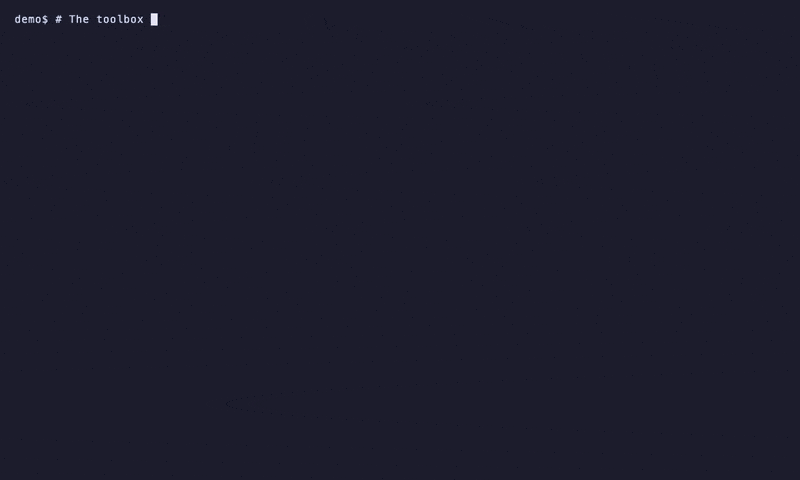

<div align="center">

<picture>
  <source media="(prefers-color-scheme: dark)" srcset="assets/logos/wp-vibe-toolbox-dark.svg">
  
</picture>

# WP Vibe Toolbox

**Build, review and maintain WordPress block themes with Mistral Vibe.**<br>
Skills and agents that turn an HTML design into a real FSE block theme, review it against WordPress standards, run your update rounds, and write SEO content that gets a second pair of eyes before it ships.

Made by a block-theme developer who uses them daily, so every workflow starts from the files and sites you already work in: `theme.json`, patterns, parts, WP-CLI, PHPCS, your local site.

[](https://github.com/imagewize/wp-vibe-toolbox/releases/latest)
[](LICENSE.md)
[](https://github.com/imagewize/wp-vibe-toolbox/commits/main)
<br>
[](https://docs.mistral.ai/vibe/)
[](https://chat.mistral.ai)
[](docs/skills.md)
[](docs/agents.md)
[](docs/le-chat-prompts.md)

[Quick start](#-quick-start) · [What's inside](#-whats-inside) · [Design principles](#-design-principles) · [Docs](#-documentation) · [Contributing](docs/contributing.md)

</div>

---

## 🎯 Why this exists

Mistral Vibe is a capable coding agent, but out of the box it doesn't know what a block theme is. Left alone it writes classic PHP templates, hardcodes colours instead of `theme.json` presets, invents blocks that don't exist, and says "done" when the page looks nothing like the design. These skills and agents fix that:

- **They know the WordPress way.** `theme.json` v3 first, patterns and parts second, CSS last, with a comment for every rule that had to live in CSS.
- **They check their own work.** Pattern validation in a real browser (`wp-pattern-sentinel`), PHPCS with the WordPress standard, and screenshots of the source and the site at 1440px and 390px, compared section by section.
- **They ask before they publish.** Update rounds need human approval. Content goes to an independent reviewer before it goes live.

### Case study: an HTML design to a block theme

[`architect-demo`](https://github.com/imagewize/architect-demo) is an architecture studio site. The `wp-frontend-builder` agent took a single `index.html` and built a [Kadewerk](https://github.com/imagewize/architect-demo/tree/main/theme-kadewerk) block theme from it: a fork of the [Aviendha](https://github.com/imagewize/aviendha) starter theme, with the homepage composed from [Aludra](https://github.com/imagewize/aludra) blocks. The write-up of each run, including what went wrong and which skill change fixed it, is in its `PROMPTS.md`.

### Works best with Aviendha and Aludra

For themes, the toolbox builds on two open-source pieces:

| Piece | Role | Why you want it |
|-------|------|-----------------|
| [Aviendha](https://github.com/imagewize/aviendha) | Lean FSE starter theme to fork | A tested `theme.json`, WooCommerce templates and the pattern-validation harness, with no pattern library to fight |
| [Aludra](https://github.com/imagewize/aludra) | Block library (hero, stat rail, feature cards, carousel, FAQ, contact section, mega menu…) | Sections the agent composes instead of hand-writing markup. **A theme built from Aludra blocks needs the plugin active, or the blocks render as empty placeholders**, so the skills make the theme say so and show an admin notice |

Plain core-block conversions (Mode A of [`/html-to-block-theme`](skills/html-to-block-theme/SKILL.md)) need neither.

---

## ✨ What's inside

| Kind | Count | Runs in | What it is |
|------|:-----:|---------|------------|
| 🛠 **[Vibe skills](docs/skills.md)** | 60 | Mistral Vibe | [Agent Skills](https://docs.mistral.ai/vibe/code/cli/skills) (`SKILL.md`) invoked as slash commands: they read your files, run git and linters, and report |
| 🤖 **[Vibe agents](docs/agents.md)** | 9 roles (+9 subagent copies) | Mistral Vibe | TOML role profiles for `vibe --agent NAME`, plus generated `<name>-subagent.toml` copies the model can spawn via `agents.spawn`; each scopes and loads its skills on demand |
| 💬 **[Le Chat prompts](docs/le-chat-prompts.md)** | 2 | Le Chat | System prompts for agents with no shell or file access, each with recorded example runs |

### The WordPress workflow

The skills and agents are built to chain, from a design to a live, maintained site:

| Step | Use | What you get |
|------|-----|--------------|
| 1. Design | [`wp-frontend-builder`](agents/wp-frontend-builder.toml) with `/design-first-ui-prompting`, `/frontend-design`, `/no-ai-design-slop` | A locked design system and an anchored HTML/CSS prototype, one section per future block pattern |
| 2. Build | [`/html-to-block-theme`](skills/html-to-block-theme/SKILL.md) | The HTML/CSS/JS design as a production FSE block theme with `theme.json` v3, patterns and parts |
| 3. Review | [`wp-reviewer`](agents/wp-reviewer.toml), [`/code-review`](skills/code-review/SKILL.md) | The diff reviewed against WordPress coding standards, every finding labelled CONFIRMED or PLAUSIBLE with a failure scenario |
| 4. Maintain | [`wp-maintainer`](agents/wp-maintainer.toml), [`/wp-update-round`](skills/wp-update-round/SKILL.md) | A full update round: before/after screenshots, pixel diff, human approval, production deploy |
| 5. Publish | [`seo-content-writer`](agents/seo-content-writer.toml) → [`seo-publish-reviewer`](agents/seo-publish-reviewer.toml) | Content planned and drafted, then handed to an independent reviewer before it goes live |

Also in the box: [`release-manager`](agents/release-manager.toml) for release readiness and [`devops-oncall`](agents/devops-oncall.toml) for incident triage that starts read-only and logs its evidence.

Skills by area (full tables in [docs/skills.md](docs/skills.md)):

| Area | Skills |
|------|:------:|
| WordPress development | 9 |
| Design & frontend | 16 |
| Development workflow & quality | 11 |
| DevOps & release | 11 |
| SEO & content marketing | 13 |

---

## 🚀 Quick start

**1. Wire the toolbox into Vibe once.** Skills go in `~/.vibe/config.toml`:

```toml
skill_paths = ["~/code/wp-vibe-toolbox/skills"]
```

Agents are synced into Vibe's own agents folder, which it searches without any config:

```bash
mkdir -p ~/.vibe/agents
rsync -a ~/code/wp-vibe-toolbox/agents/ ~/.vibe/agents/   # re-run after git pull
```

(Don't add `--delete` if you keep private profiles in `~/.vibe/agents/` — it would remove
them. A symlink works too and stays current automatically, but it dangles silently if the
repo moves — see [agents/README.md](agents/README.md#wiring-them-into-any-repository).)

**2. Use it in any repository:**

```bash
cd ~/code/some-wordpress-project
vibe                                        # then: /html-to-block-theme, /wp-update-round, /code-review, …
vibe --agent wp-frontend-builder            # design to block theme
vibe --agent wp-reviewer -p "review the diff against main"
vibe --agent release-manager -p "is main ready for release?"
```

A live run — `wp-reviewer` reviewing the latest commit in this repo, loading the `code-review` skill on demand and ending with a `file:line` verdict:



**3. Or, in Le Chat**, paste [`prompts/frontend-dev/FRONTEND-DEV.md`](prompts/frontend-dev/FRONTEND-DEV.md) into **Agents → New Agent → System Prompt**.

Per-project install, approval allowlists and AGENTS.md vs system prompt: [docs/install.md](docs/install.md).

---

## 🧭 Design principles

What makes these different from a pile of prompts:

- **Vibe-native, not ported.** Skills follow the Agent Skills format with `metadata.version`, so copies in projects can be compared. Agents are plain TOML with scoped `enabled_skills`. Commands are written from each tool's real interface (checked against `--help` and MCP schemas).
- **Allowlist-friendly.** Skills prescribe plain single commands: no shell loops, no `$(…)`, no one-liner interpreters. A project can approve them once in `[tools.bash] allowlist` and stop seeing prompts.
- **Evidence before claims.** Review output carries `file:line` references and a failure scenario per finding; completion requires running the proving command fresh. False positives are treated as a defect.
- **Project rules live in the project.** Skills stay generic across WordPress projects. Per-repo rules go in `.agents/` files such as `.agents/code-review.md`, so one skill serves many codebases.
- **Honest provenance.** 50 of the 60 skills are adapted from permissively licensed open-source collections. Each keeps its upstream `LICENSE`, records the pinned commit in `metadata.source`, and is logged in [`NOTICE.md`](NOTICE.md) and [`docs/sources.md`](docs/sources.md).
- **Public-safe.** No client hostnames, credentials or per-client lists; real values live in private per-site files.
- **Le Chat prompts are tested.** Each prompt ships with recorded runs (input, raw output, review feedback), including failures, so you can see how it behaves before pasting it.

---

## 📚 Documentation

| Doc | Contents |
|-----|----------|
| [docs/skills.md](docs/skills.md) | Every skill by area with source, plus the `/code-review`, `/wp-update-round`, `/real-browser-control`, design and content workflows |
| [docs/agents.md](docs/agents.md) | Agent profiles, the skills each loads, wiring and subagents |
| [docs/le-chat-prompts.md](docs/le-chat-prompts.md) | The Le Chat prompts, how to use them, example runs |
| [docs/install.md](docs/install.md) | User-wide and per-project install, project rules, approvals, real-browser MCP setup |
| [docs/contributing.md](docs/contributing.md) | Adding a skill, agent or prompt |
| [docs/sources.md](docs/sources.md) · [NOTICE.md](NOTICE.md) | Source register, pinned commits, third-party licenses |
| [AGENTS.md](AGENTS.md) · [CHANGELOG.md](CHANGELOG.md) | Rules for agents working in this repo · release history |

```
wp-vibe-toolbox/
├── skills/    # Vibe skills: skills/<name>/SKILL.md (+ LICENSE for imported skills)
├── agents/    # Vibe agent profiles: agents/<name>.toml
├── prompts/   # Le Chat prompts + example runs
└── docs/      # User docs, sourcing plan, source register
```

---

## 🙏 Credits

Adapted from [obra/superpowers](https://github.com/obra/superpowers) · [addyosmani/agent-skills](https://github.com/addyosmani/agent-skills) · [mralaminahamed/wp-dev-skills](https://github.com/mralaminahamed/wp-dev-skills) · [NotHarshhaa/devops-skills](https://github.com/NotHarshhaa/devops-skills) · [jakubkrehel/skills](https://github.com/jakubkrehel/skills) · [MengTo/Skills](https://github.com/MengTo/Skills) · [BagelHole/DevOps-Security-Agent-Skills](https://github.com/BagelHole/DevOps-Security-Agent-Skills) · [Ilm-Alan/frontend-design](https://github.com/Ilm-Alan/frontend-design) · [siddik-web/wp-block-theme-converter](https://github.com/siddik-web/wp-block-theme-converter) · [nextlevelbuilder/ui-ux-pro-max-skill](https://github.com/nextlevelbuilder/ui-ux-pro-max-skill) · [content-designer/ux-writing-skill](https://github.com/content-designer/ux-writing-skill) · [plugin87/ux-ui-agent-skills](https://github.com/plugin87/ux-ui-agent-skills) · [google-labs-code/design.md](https://github.com/google-labs-code/design.md) · [coreyhaines31/marketingskills](https://github.com/coreyhaines31/marketingskills) · [guillaumemeyer/watermarks-remover](https://github.com/guillaumemeyer/watermarks-remover) · [aaron-he-zhu/aaron-marketing-skills](https://github.com/aaron-he-zhu/aaron-marketing-skills) (method reference only) · [ofershap/real-browser-mcp](https://github.com/ofershap/real-browser-mcp)

All MIT except `google-labs-code/design.md` and `aaron-he-zhu/aaron-marketing-skills` (Apache-2.0). Resources: [Mistral Vibe docs](https://docs.mistral.ai/vibe/) · [Vibe skills](https://docs.mistral.ai/vibe/code/cli/skills) · [Vibe agents](https://docs.mistral.ai/vibe/code/cli/agents) · [Le Chat](https://chat.mistral.ai)

**Logo.** The box mark is the `box` icon from [Bootstrap Icons](https://icons.getbootstrap.com/icons/box/) (via [Blade Icons](https://blade-ui-kit.com/blade-icons/bi-box)), MIT License, © 2019-2024 The Bootstrap Authors; the license text is in [`assets/logos/LICENSE-bootstrap-icons.txt`](assets/logos/LICENSE-bootstrap-icons.txt). It is a nod to the [Traveling box](https://wot.fandom.com/wiki/Traveling_box) from Robert Jordan's *The Wheel of Time*, in the spirit of the other Imagewize projects named after that series ([Aviendha](https://github.com/imagewize/aviendha), [Aludra](https://github.com/imagewize/aludra), [Elayne](https://github.com/imagewize/elayne), [Nynaeve](https://github.com/imagewize/nynaeve)). Light and dark variants swap automatically on GitHub.

## 📄 License

[MIT](LICENSE.md) © Imagewize. Third-party skills keep their own licenses (MIT, one Apache-2.0); see [NOTICE.md](NOTICE.md).

<div align="center"><sub>Created and maintained by <a href="https://imagewize.com">Imagewize</a>.</sub></div>
